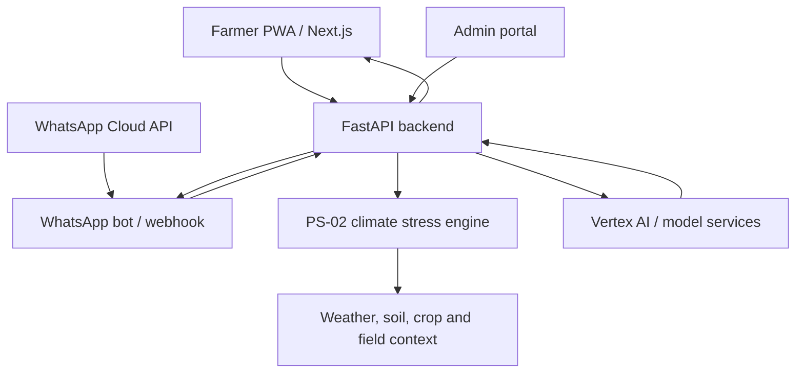
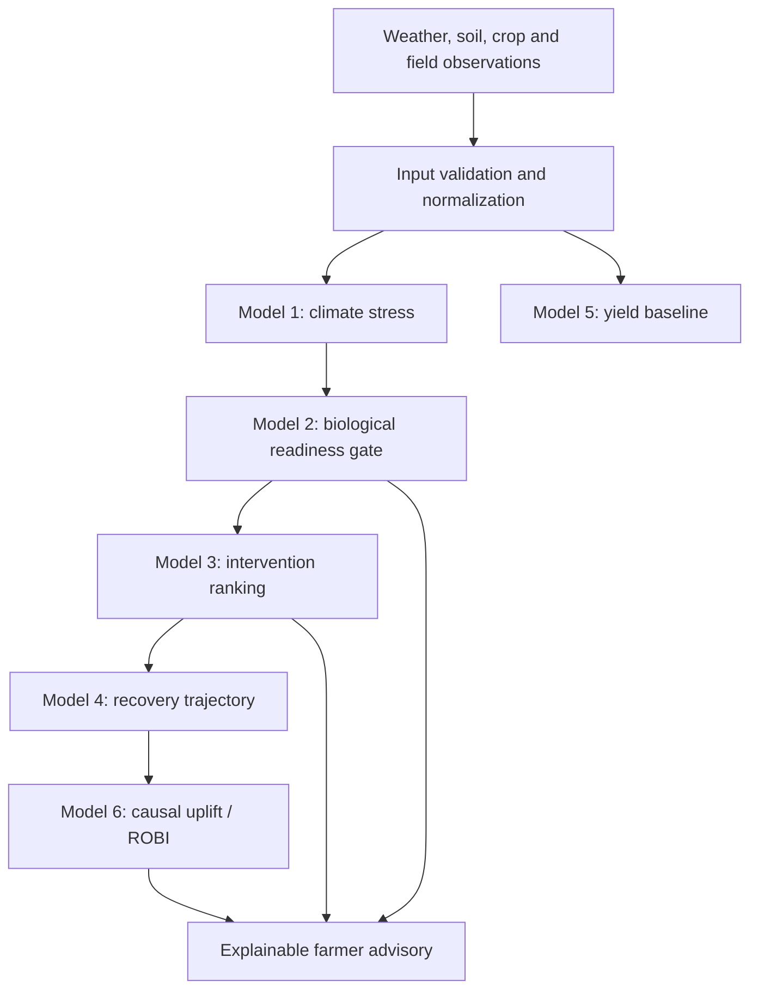

# KrishYantra — System Architecture

**Status:** Architecture baseline derived from the repository's published project guide. Verify implementation details against source before making structural changes.

## 1. System context

KrishYantra is organized as a multi-service application: a Next.js farmer experience, Python API/orchestration, a dedicated PS-02 climate-stress engine, model services, an admin portal, and messaging/bot integrations.



## 2. Repository map

| Path | Responsibility |
|---|---|
| `frontend/` | Next.js App Router farmer PWA and decision-support UI |
| `backend/` | FastAPI service, API routes and cloud-model bridge |
| `ps02-engine/` | Biological readiness / microclimate stress computation |
| `vertex_ai/` | Definitions and deployment code for Models 1–6 |
| `admin/` | Operations and extension-officer portal |
| `whatsapp-bot/` | WhatsApp Cloud API integration, conversational and image intake |
| `bot/` | Standalone terminal bot utilities |
| `docs/` | Architecture, ML manuals, research and supporting material |
| `AGENTS.md` | Workspace-level UI and deployment constraints |
| `package.json` | Root development orchestration |

## 3. Technology baseline

The repository guide identifies:

- Frontend: Next.js 16 App Router, Turbopack, TypeScript/React ecosystem.
- Backend: Python FastAPI.
- ML bridge/deployment: Google Vertex AI.
- Climate engine: Python service.
- Messaging: Meta WhatsApp Cloud API.
- Deployment: Vercel for the web application.

Treat these as documented baseline, not proof that every environment is currently configured. Check lockfiles, requirements files, environment examples and deployment settings before changing versions.

## 4. Six-stage intelligence pipeline

The published architecture describes the following logical model stages. Their exact input/output schemas must be read from each model implementation.

| Stage | Purpose | Documented approach |
|---|---|---|
| Model 1 | Multi-stress climate risk / early warning | XGBoost and Random Forest ensemble |
| Model 2 | Biological readiness and spray-safety gate | Delta-T, VPD / wind / rain-related constraints |
| Model 3 | Biological product ranking | LambdaMART / XGBRanker |
| Model 4 | Crop recovery / intervention support | Recovery trajectory and rotational countermeasures |
| Model 5 | Yield baseline / potential estimate | Yield regression |
| Model 6 | Causal uplift and ROBI | Double ML / EconML causal forest |

Logical flow:



**Important:** A later stage must not silently bypass a failed prerequisite. In particular, a readiness gate should fail closed when required safety inputs are missing or stale.

## 5. Backend responsibilities

The published guide identifies these key entry points:

- `backend/app/main.py` — FastAPI application setup, middleware and error handling.
- `backend/app/routers/pipeline.py` — orchestration of the model pipeline.
- `backend/tunnel_bridge.py` — local development bridge to Vertex AI.
- `backend/check_vertex_status.py` — cloud endpoint health checks.

Recommended service boundaries:

1. **API layer:** request validation, authentication/authorization, response contracts.
2. **Orchestration layer:** workflow coordination, timeout handling, retries and correlation IDs.
3. **Domain engines:** deterministic agronomic calculations and business rules.
4. **Model adapters:** versioned model invocation and response normalization.
5. **Data adapters:** weather, soil, market and product reference data.
6. **Audit layer:** provenance, model version, timestamps and decision trace.

Keep deterministic safety rules separate from probabilistic model output.

## 6. Frontend responsibilities

The frontend is the farmer-facing decision platform. The published guide calls out:

- Plant intelligence and prescription experience.
- Farmer-readable “Why” and “How” explanations.
- Acreage- and soil-aware calculations.
- Cultural / no-cost advisory.
- Impact / ROBI view.
- Recovery workflow.
- Shared prediction hook and advisory translation logic.

Keep UI components presentational where possible. Put API access, caching and transformation in typed hooks/services. Do not duplicate agronomic calculations in React components.

## 7. External integrations and data contracts

Documented integration categories include:

- Weather / microclimate APIs (including Open-Meteo and Meteoblue references).
- Soil and crop reference data.
- APMC / Agmarknet market benchmarks.
- Vertex AI inference endpoints.
- Meta WhatsApp Cloud API.
- Image/vision inference provider.

For every integration, record: owner, endpoint, authentication method, request/response schema, units, refresh cadence, timeout, retry policy, rate limits, licensing, and fallback behavior. Never commit API keys.

## 8. Runtime and local development

The root scripts documented in `package.json` coordinate:

```bash
npm install
npm run dev
```

The documented individual service commands are:

```bash
# Frontend
cd frontend
npm install
npm run dev

# Backend
cd backend
python -m venv venv
# Windows: .\venv\Scripts\activate
# macOS/Linux: source venv/bin/activate
pip install -r requirements.txt
uvicorn app.main:app --reload --port 8000

# PS-02 engine
cd ps02-engine
python app.py

# Admin
cd admin
npm install
npm run dev -- -p 3001
```

Check the current scripts and dependency manifests before relying on these commands; service ports and requirements may change.

## 9. Reliability and security

- Use explicit timeouts for all network/model calls.
- Retry only transient failures; use bounded exponential backoff.
- Validate units, ranges, timestamps and missing values at service boundaries.
- Add request IDs and structured logs; avoid logging secrets or unnecessary personal data.
- Restrict CORS, admin routes, webhook verification and model endpoints.
- Keep secrets in environment variables / deployment secret stores.
- Cache only with a documented freshness policy.
- Return typed errors and safe fallback states instead of fabricated recommendations.

## 10. Architecture decision record template

For consequential changes, add an entry:

- **Decision:** What is changing?
- **Context:** What problem requires it?
- **Options:** What alternatives were considered?
- **Choice:** What was selected and why?
- **Consequences:** Trade-offs, migration and operational impact.
- **Date / owner:** Who approved it and when?
